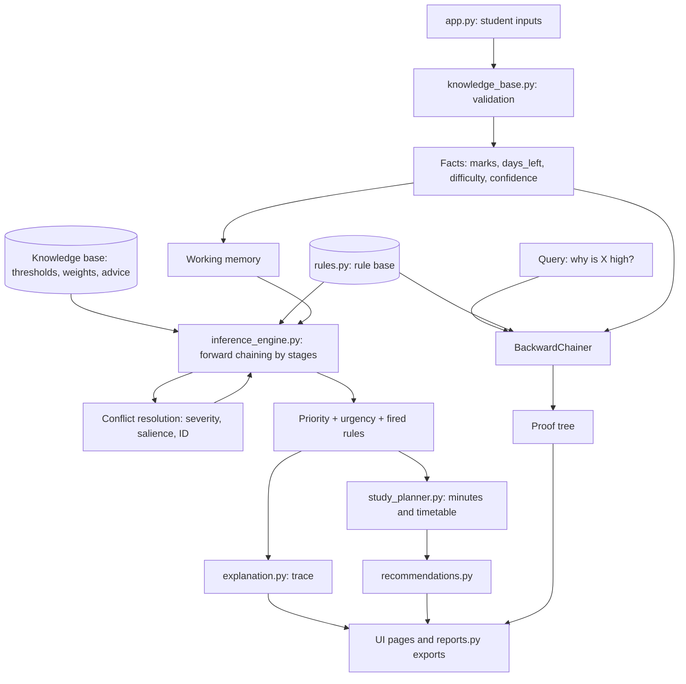

# Smart Study Advisor: A Rule-Based Knowledge Representation and Reasoning System

A Streamlit application that turns a student's marks, exam deadlines, subject difficulty and daily study hours into
**study priorities, reasons and a study plan**, using explicit facts, IF-THEN rules and an inference engine.
It is a symbolic KRR project. There is **no machine learning** anywhere.

## 1. Project structure

```text
smart_study_advisor/
├── app.py                  # Streamlit UI (7 pages). Shows data only; contains no reasoning
├── ui_styles.py            # Colours and custom CSS
├── knowledge_base.py       # Facts, thresholds, weights, advice texts, input validation
├── rules.py                # The rule base (IF-THEN rules as data) + conflict-strategy text
├── inference_engine.py     # Forward chaining, conflict resolution, backward chaining
├── explanation.py          # Builds reasoning traces and proof trees from real evaluations
├── study_planner.py        # Study-time allocation + multi-day timetable
├── recommendations.py      # Turns conclusions + minutes into advice
├── advisor.py              # Pipeline: subjects -> facts -> rules -> plan -> advice
├── reports.py              # CSV / JSON / printable summary
├── requirements.txt
├── .streamlit/config.toml  # Colour theme
├── tools/ui_stub_smoke.py  # Runs every page with stand-in Streamlit (no install needed)
├── tests/                  # 66 automated tests (unittest; pytest also works)
└── docs/                   # SAMPLE_TRACE.md and TEST_RESULTS.md (generated from real runs)
```

I split `inference_engine.py`, `explanation.py`, `advisor.py` and `reports.py` out of the suggested layout so each file
has one job (reasoning, explaining, wiring, exporting). `app.py` stays short and never makes decisions.

## 2. Setup on Windows with VS Code

1. Install **Python 3.12** from python.org (tick "Add python.exe to PATH"). Install VS Code and its *Python* extension.
2. Unzip the project, then in VS Code: **File > Open Folder** and choose `smart_study_advisor`.
3. Open a terminal (**Terminal > New Terminal**, PowerShell) and run:

```powershell
py -3.12 -m venv .venv
.venv\Scripts\Activate.ps1
pip install -r requirements.txt
streamlit run app.py
```

If PowerShell blocks the activation script, run once: `Set-ExecutionPolicy -Scope CurrentUser RemoteSigned`.
The browser opens at http://localhost:8501.

Run the tests (no extra install needed):

```powershell
python -m unittest discover -s tests -t . -v
# optional: pip install pytest ; pytest
python tools/ui_stub_smoke.py
```

## 3. How the project maps to KRR

| KRR concept | Where it lives | Example |
|---|---|---|
| Knowledge representation (facts / predicates) | `knowledge_base.Fact` | `marks(Artificial Intelligence, 40)` |
| Knowledge base (thresholds and domain knowledge) | `KnowledgeBase`, `DEFAULT_THRESHOLDS` | `low_marks = 50` |
| Rule base | `rules.build_rules()` | `R1: IF marks < 50 AND days_left <= 7 THEN base_candidate = high` |
| Working memory | `WorkingMemory` | input facts + derived facts |
| Forward chaining | `InferenceEngine.infer` | facts -> urgency -> base priority -> final priority |
| Conflict resolution | `resolve_conflict` | R2 says High, R4 says Medium: High wins |
| Intermediate conclusions | derived facts | `urgency(AI, urgent)`, `base_priority(AI, high)` |
| Negation as failure | `Condition(..., "absent")` | R7 fires only if no base rule fired |
| Backward chaining | `BackwardChainer` | goal `priority(AI, high)`: which rules and facts prove it? |
| Explanation facility | `explanation.py` | step-by-step trace |

### The rules (defaults)

| ID | Stage | IF | THEN |
|---|---|---|---|
| U1-U4 | urgency | days_left <= 1 / 2-3 / 4-7 / > 7 | urgency = critical / urgent / soon / comfortable |
| R1 | base | marks < 50 AND days_left <= 7 | High |
| R2 | base | days_left <= 3 | High |
| R3 | base | marks < 50 | High |
| R4 | base | 50 <= marks < 65 | Medium |
| R6 | base | marks >= 80 AND days_left > 7 AND difficulty = low | Low |
| R7 | default | no base rule fired | default priority (Medium) |
| R5 | adjust | difficulty = high AND base priority is not High | raise one level |
| R8 | adjust | confidence <= 2 AND base priority is not High | raise one level |

**Design decisions** (I refined your starting set; the final semantics are):
* R5 is an *adjustment on an intermediate conclusion*. It runs after the base priority is known, so it needs a second reasoning stage.
* R5 and R8 together raise the priority by **at most one level**, never above High.
* R7 (default) is a separate stage so it can truly check "nothing else fired". Its value, Medium, is a configurable threshold.
* Conflict strategy: most severe level wins; ties go to higher salience, then the smaller rule ID. Rule storage order never matters (a test shuffles the rules 10 times).

## 4. Module guide (what, why, KRR link, how to change, how to demo)

**knowledge_base.py**: *What:* defines `Fact`, `Subject`, the `KnowledgeBase`, thresholds and validation. *Why:* the reasoner must only see clean data, and rules should not contain magic numbers. *KRR:* this is knowledge representation. *Change safely:* edit a number in `DEFAULT_THRESHOLDS` (or use the UI form); the constructor rejects inconsistent values such as `low_marks > medium_marks`. *Demo:* open **Knowledge Base & Rules > Knowledge base**, change `low_marks` to 60 and watch priorities change.

**rules.py**: *What:* each rule is a `Rule` object with conditions and a conclusion. *Why:* keeping rules as data makes them inspectable and editable without touching the engine. *KRR:* this is the rule base (production rules). *Change safely:* copy an existing rule, give it a new unique ID, choose a stage, use `@threshold` names, then run the tests. *Demo:* show the Rules tab and the "Fired for" column.

**inference_engine.py**: *What:* forward chaining (stage by stage until no rule can fire), conflict resolution, and a backward-chaining proof search. *Why:* this is the "reasoning" itself. *KRR:* data-driven versus goal-driven inference. *Backward chaining here is real goal-driven search:* given `priority(S, L)` it tries two clauses (A: base level equals L and no boost; B: base level is one below L and a boost applies), finds the rules concluding each sub-goal, and checks their conditions against facts. Tests confirm it agrees with forward chaining for 648 input combinations. *Demo:* **Reasoning Trace > Backward chaining**, ask "high" then "low".

**explanation.py**: *What:* formats the evaluations the engine recorded. *Why:* explainable AI; the trace is never typed by hand. *Demo:* show a trace where rules did *not* match: the false conditions with actual values are listed too.

**study_planner.py**: *What:* splits daily time into blocks, weights High/Medium/Low as 3/2/1, and uses the largest-remainder method so whole blocks sum correctly. *Why:* a deterministic, explainable allocation that never exceeds the limit. *KRR link:* weights are knowledge in the KB. It flags rounding leftovers, sessions under 30 minutes, and too little time for too many subjects. An exam today appears only on day 0; on an exam day a subject gets half weight.

**recommendations.py / advisor.py / reports.py**: combine conclusions with advice texts, run the whole pipeline once, and export from that single result, so CSV, JSON, summary and screen always agree.

### Data flow



## 5. Sample input and expected output

Sample data (built in, labelled as demo data in the app), 4 study hours per day:

| Subject | Marks | Days left | Difficulty | Confidence | Fired rules | Final priority | Daily time |
|---|---|---|---|---|---|---|---|
| Artificial Intelligence | 40 | 2 | High | 2 | U2, R1, R2, R3 | High | 1 h |
| Operating Systems | 62 | 4 | High | 4 | U3, R4, R5 | High (Medium raised by R5) | 1 h |
| Database Systems | 72 | 10 | Medium | 3 | U4, R7 | Medium | 45 min |
| Statistics | 55 | 6 | Medium | 3 | U3, R4 | Medium | 45 min |
| English Communication | 88 | 14 | Low | 5 | U4, R6 | Low | 30 min |

Full traces: `docs/SAMPLE_TRACE.md` (generated by the real engine). Test list and results: `docs/TEST_RESULTS.md`.

## 6. Five-minute demo for your instructor

1. **Student Inputs:** show the sample data, change AI marks from 40 to 90.
2. **Recommendations:** the priority and advice change.
3. **Knowledge Base & Rules:** show facts, rule table, "Rules fired".
4. **Reasoning Trace:** pick AI, show R1, R2, R3 matching and the conflict step.
5. **Backward chaining:** ask "why high?" and read the proof tree.
6. **Study Planner:** show totals, notes and the multi-day timetable.
7. **Reports:** download CSV, JSON and the printable summary.

## 7. Limitations

* Cut-offs are sharp (49.9% versus 50%).
* Only four inputs are used: no topic weights, syllabus size or exam format.
* Rules and weights are hand-made, not learned.
* Plans are advisory and ignore sleep, classes and personal habits.
* Backward chaining covers the final-priority goal only, not every predicate.
